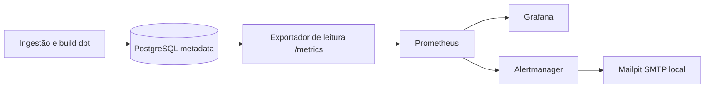

# Observabilidade do NYC Mobility

## Escopo entregue

A observabilidade complementa os registros de execução do pipeline. Permite observar a
publicação de dados, o resultado e a duração do último build concluído e a disponibilidade
da coleta dessas informações. O ambiente é local e opcional, ativado pelo perfil
`observability` do Docker Compose.

O projeto foi encerrado neste escopo de estudo. As limitações abaixo são fronteiras da
entrega, não funcionalidades em implementação.

## Caminho da informação



As setas representam o fluxo da informação. A iniciativa das consultas é do exportador
ao banco, do Prometheus ao exportador e do Grafana ao Prometheus. O pipeline não envia
métricas diretamente e não depende da disponibilidade dessa stack para processar dados.

| Componente | Responsabilidade | Arquivos principais |
|---|---|---|
| PostgreSQL | Histórico de builds e marcador da publicação validada | `metadata.analytics_runs`, `metadata.analytics_publication` |
| Exportador | Converter consultas em métricas HTTP | `dashboard/metrics.py`, `dashboard/db.py` |
| Prometheus | Coletar séries temporais, executar PromQL e avaliar regras | `observability/prometheus.yml`, `observability/alerts.yml` |
| Grafana | Consultar e apresentar os indicadores | `observability/grafana/` |
| Alertmanager | Agrupar alertas e enviar notificações | `observability/alertmanager.yml` |
| Mailpit | Capturar e-mails no ambiente local | serviço `mailpit` em `docker-compose.yml` |

O exportador reutiliza a imagem e a conexão somente leitura do dashboard em um processo
separado. Usa `dashboard_reader`, sem receber a credencial administrativa do banco. A
coleta lê publicação e último build numa transação `REPEATABLE READ`, sem escrever no banco.
Erro na consulta retorna HTTP 503; não se inventa uma publicação ou um sucesso de build.

## Métricas e semântica

| Métrica | Tipo | Interpretação |
|---|---|---|
| `nyc_mobility_publication_timestamp_seconds` | Gauge | Instante Unix da última publicação validada |
| `nyc_mobility_build_success` | Gauge | Último build concluído: 1 para sucesso e 0 para falha |
| `nyc_mobility_build_duration_seconds` | Gauge | Duração do mesmo build, em segundos |
| `up{job="nyc_mobility"}` | Gauge gerado pelo Prometheus | 1 se a última coleta do exportador foi válida; 0 se falhou |

Uma gauge representa um valor observado. As métricas do build não são contadores de
execuções nem histogramas de duração. O Prometheus guarda suas observações ao longo do
tempo, mas vários builds entre duas coletas podem não aparecer individualmente. Para o
histórico completo, consulte o Pipeline Health e `metadata.analytics_runs`.

Sem publicação ou build concluído, a respectiva métrica não tem amostra. Isso é diferente
de zero. Um build em andamento mantém o resultado do último concluído; um processo morto
que permaneça `running` não será identificado como falha por essa métrica.

As métricas não recebem labels de execução, competência ou mensagem de erro. Os labels
`job` e `instance` do Prometheus identificam a coleta, mantendo poucas séries estáveis.
IDs, resultados dbt e erros detalhados continuam nos metadados e logs.

Consultas para experimentar no Prometheus:

```promql
# A última coleta funcionou?
up{job="nyc_mobility"}

# Quantas horas se passaram desde a última publicação validada?
(time() - nyc_mobility_publication_timestamp_seconds) / 3600

# Qual foi o resultado e quanto durou o último build concluído?
nyc_mobility_build_success
nyc_mobility_build_duration_seconds
```

Idade da publicação não mede atraso da fonte ou cobertura do histórico. Um build pode
publicar novamente os mesmos meses. Da mesma forma, uma publicação antiga pode continuar
correta se a TLC ainda não disponibilizou uma nova competência.

## Coleta e apresentação

O Prometheus coleta a si mesmo e o exportador a cada 15 segundos e avalia as regras a cada
15 segundos. No Grafana, quatro indicadores mostram idade da publicação, última coleta,
resultado e duração do último build. As consultas são instantâneas e o painel atualiza a
cada 30 segundos. Há, portanto, atraso normal entre uma mudança no banco e sua apresentação.

Fonte de dados e painel são provisionados por arquivos versionados. O Grafana usa a URL
interna `http://prometheus:9090`; não acessa diretamente o PostgreSQL. O provisionamento
evita depender de alterações manuais na interface para reproduzir o ambiente.

Se uma métrica deixa de chegar, o Prometheus aplica sua semântica de staleness. Ausência
de amostra não equivale a falha de build nem a sucesso. Uma avaliação que não retorna
série pode encerrar um alerta de build; o alerta de coleta precisa ser observado junto.

## Alertas e notificações

| Regra | Condição | Persistência necessária |
|---|---|---|
| `ExportadorIndisponivel` | `up{job="nyc_mobility"} == 0` | 2 minutos |
| `UltimoBuildFalhou` | `nyc_mobility_build_success == 0` | 1 minuto |

Os dois alertas têm severidade `warning`. Os tempos são didáticos para o ambiente local.
Não existe alerta configurado para idade da publicação.

O estado é `inactive` quando a condição não está presente, `pending` enquanto aguarda
o tempo de persistência e `firing` após esse tempo. Uma condição que desapareça antes do
limite não dispara. Um novo build em andamento não resolve a falha do último concluído;
um build posterior bem-sucedido muda o resultado para 1.

O Prometheus encaminha alertas ativos ao Alertmanager. A configuração agrupa por
`alertname`, espera 30 segundos antes da primeira notificação, espera 5 minutos entre
atualizações do grupo e pode repetir uma notificação persistente após 4 horas.
`send_resolved: true` habilita o e-mail de recuperação; ele também respeita o agrupamento.

O receptor `local` envia por SMTP a `mailpit:1025`, usando endereços fictícios
`example.test`. O SMTP não é publicado no host, não usa TLS nessa rede de teste e não
há encaminhamento para uma caixa externa. A interface do Mailpit permite inspecionar
assunto, conteúdo e destinatários dos e-mails `FIRING` e `RESOLVED`.

## Execução e persistência

Com o `.env` configurado, siga o [README](README.md#observabilidade-local) para iniciar o
conjunto e aplicar as migrações. As interfaces locais são:

- Prometheus: <http://127.0.0.1:9090>.
- Grafana: <http://127.0.0.1:3000/d/nyc-publication>.
- Alertmanager: <http://127.0.0.1:9093>.
- Mailpit: <http://127.0.0.1:8025>.

`prometheus-data` preserva séries; `grafana-data` preserva o estado do Grafana;
`alertmanager-data` preserva silêncios e estado de notificações. Esses volumes não são
backups e não configuram alta disponibilidade. A caixa Mailpit não tem volume persistente.
As portas das interfaces ficam restritas a localhost; o Grafana permite leitura anônima.

Para parar só o monitoramento, preservando seus volumes e o pipeline:

```bash
docker compose stop prometheus metrics-exporter grafana alertmanager mailpit
```

## Validação realizada e reproduzível

- Testes Python: formato das métricas, sucesso/falha de build, ausência de histórico e
  HTTP 503 em erro de banco (`tests/test_metrics.py`).
- `promtool`: configuração e cenários de alerta, incluindo espera, disparo e recuperação.
- `amtool`: configuração de rotas e receptor SMTP.
- Consultas reais: métricas do PostgreSQL coletadas pelo Prometheus e consultadas pelo Grafana.
- Teste de falha de coleta: interrupção temporária do exportador, chegada do alerta ao
  Alertmanager e retorno de `up=1` após restabelecimento do serviço.
- Script `scripts/testar_notificacao_local.py`: alerta sintético diretamente no
  Alertmanager e recebimento dos dois e-mails no Mailpit, sem interromper o pipeline.

O job `observability` no CI valida Compose, Prometheus, Alertmanager e regras, além de
iniciar um Grafana descartável para conferir os quatro painéis e sua fonte de dados.
Esse job não testa a coleta ao banco nem a entrega SMTP. O teste SMTP demora vários
minutos e permanece manual. A conferência dos painéis foi por API; não houve validação visual.

## Limites da entrega

Não foram implementados logs centralizados, traces distribuídos, alertas por falha de
ingestão, calendário de disponibilidade das fontes, identificação de builds travados,
monitoramento externo da própria stack, backups ou notificações de produção. Os alertas
não corrigem nem reexecutam tarefas automaticamente. Não se definiu uma política própria
de retenção ou dimensionamento; os serviços usam os padrões das imagens onde não há
configuração explícita. Isso encerra o escopo local de estudo sem pressupor operação produtiva.
